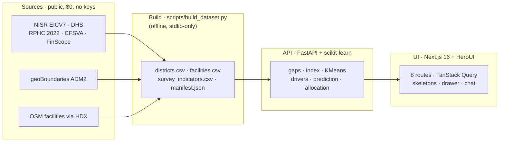

<div align="center">


# Rwanda Compass

### *Put the next franc where need is greatest.*

**District development intelligence for Rwanda's 30 districts — live Need score, ML typologies, counterfactual prediction, and auditable budgets.**

[](https://github.com/daadygod-dev/rwako)
[](docs/METHODOLOGY.md)
[](data/processed/manifest.json)
[](server/tests)
[](https://creativecommons.org/licenses/by/4.0/)

<sub>NISR 2026 Big Data Hackathon · <b>Track 3: Open Innovation</b> · *"Tackling national priorities as per NST2, Vision 2050"*</sub>

[Live Demo](#-quickstart) · [How it works](#-how-it-works) · [API](#-api-reference) · [Methodology](docs/METHODOLOGY.md) · [System design](docs/SYSTEM_DESIGN.md)

</div>

---

## 📖 Project overview

Rwanda's 30 districts start from very different places on the road to Vision 2050 — but the evidence planners need is scattered across NISR publications and open datasets in formats that don't compare. **Rwanda Compass** unifies that evidence into one platform that answers the question every planning cycle asks:

> **Given a limited budget, which districts — and which interventions — should come first, and why?**

| # | What it does | How |
|---|---|---|
| 1 | **Unifies** district indicators from NISR + open sources | Offline stdlib builder → versioned CSV product + provenance manifest |
| 2 | **Ranks** every district with a transparent, weight-configurable Need score | Min–max deprivation gaps → weighted mean, renormalized per district |
| 3 | **Segments** districts into intervention typologies with ML | K-Means + PCA + silhouette, severity-ordered groups |
| 4 | **Predicts** outcomes under planner-edited scenarios | Gradient boosting + leave-one-out validation, clipped to observed ranges |
| 5 | **Simulates** budget splits that sum exactly | Proportional allocation + per-district floor, largest-remainder rounding |
| 6 | **Answers** in plain language with charts | Grounded chat analyst (Ask) over live tools — no invented numbers |

---

## ✨ Features

| Surface | Route | What you get |
|---|---|---|
| 🏠 **Hero** | `/` | Live headline stats, top-5 need list, 3-step method — all from the API |
| 🗺️ **Map & ranking** | `/map` | d3-geo choropleth (ocean, graticule, hover cards with top gaps), quantile-bin legend filter, province chips, synced ranking list |
| 🎚️ **Need score builder** | `/priority-index` | Weight sliders grouped by pillar, presets, chart/ranking toggle, shareable `?w=` URLs |
| 🧩 **Typologies** | `/typologies` | PCA scatter + severity-worded group cards with member chips and defining gaps |
| 🔍 **Drivers** | `/drivers` | **Explain** (gradient-boost importances) + **Predict what-if** (district + scenario sliders, baseline vs predicted, LOO trust report) |
| 💸 **Simulator** | `/simulator` | Envelope + floor controls, chart/table toggle, exact-sum table, CSV export |
| 💬 **Ask** | `/assistant` | Chat with the data: rankings, comparisons, drivers, clusters, budgets — with auto-built bar/donut/table visuals and one-tap weight applying |
| ℹ️ **Data & method** | `/data` | Availability chips, pillar-grouped catalog with filter, provenance table, method summary |

Every page follows one grammar: **verdict strip → controls → content → footnote**. Loading states are shape-matched skeletons; empty states are honest *"data needed"* cards — never mock data.

---

## ⚙️ How it works



**Design rules** (enforced in code, not just docs): single source of truth = `data/processed/` · coverage-gated indicators (≥90%) · request-time stateless inference (`random_state=42`) · no imputation in rankings · every response stamped `as_of` · target always excluded from its own features.

---

## 🛠️ Stack & technology

| Layer | Technology | Why |
|---|---|---|
| Backend | **Python · FastAPI** + Pydantic v2 | Typed, schema-validated REST at `/api/v1/*` |
| ML | **scikit-learn** (KMeans, PCA, GradientBoosting, LeaveOneOut) | Runs in-request on 30 rows — milliseconds, always fresh |
| Data build | **Python stdlib only** | Zero-dependency offline builder anyone can audit |
| Frontend | **Next.js 16** (Turbopack) + TypeScript + Tailwind v4 | Static prerender, 9 routes |
| UI system | **HeroUI v3** + custom lime theme | Compound components, semantic variants, `onPress` a11y |
| Charts / map | **Recharts** + **d3-geo** (SVG, no tiles/keys) | Works fully offline |
| State | TanStack Query (server) + Zustand (UI, persisted) | Every mutation refetches live |
| Chat model | Any **OpenAI-compatible** endpoint (default: keyless) | Server-side only — keys never reach the browser |
| Tests | **pytest** (48) · `tsc` · `next build` | Backend contract + frontend types + prod build |

---

## 🚀 Quickstart

**Prerequisites:** Python 3.12+, Node 20.9+, no API keys needed (chat works keyless out of the box).

```bash
# 1 — clone
git clone https://github.com/daadygod-dev/rwako.git && cd rwako

# 2 — rebuild the data product (offline)
python scripts/build_dataset.py
# → OK: 30 districts, 1485 facilities (0 unmatched) + survey join report

# 3 — backend (http://127.0.0.1:8000 — docs at /docs)
pip install -r requirements.txt
uvicorn server.app:app --reload

# 4 — frontend (http://localhost:3000)
cd web && npm install && npm run dev
```

> The chat analyst works immediately with **no keys**. For higher limits, set an endpoint key in `.env` (see `.env.example`):
> ```env
> ASSISTANT_API_KEY=pollen-xxx      # optional, unlimited replies
> # ASSISTANT_MODEL=openai           # optional override
> ```

---

## ⌨️ Commands & libraries (judges' cheat sheet)

| Command | What it proves |
|---|---|
| `python scripts/build_dataset.py` | Reproduces the entire data product offline from `data/raw/` |
| `python -m pytest server/tests -q` | **52 tests**: gaps, index renormalization, allocation exactness, typologies determinism, driver leakage guards, prediction LOO, chat tools, API contracts |
| `npx tsc --noEmit` (in `web/`) | Frontend type safety |
| `npm run build` (in `web/`) | Production build — 10/10 static routes |
| `curl -X POST localhost:8000/api/v1/analysis/predict -H 'Content-Type: application/json' -d '{"target":"poverty_rate","adm2_pcode":"RW25","scenario":{"electricity_access":80}}'` | Live counterfactual prediction with LOO report |

**Key libraries:** `fastapi · pydantic · pandas · scikit-learn · pytest` (backend) — `next · react · heroui · recharts · d3-geo · zustand · @tanstack/react-query · react-markdown` (frontend). No paid services, no API keys required, no tile servers.

---

## 🔌 API reference

Base: `http://127.0.0.1:8000` · interactive docs at `/docs` · all POST bodies are JSON, errors are RFC-7807.

| Method & path | Body | Returns |
|---|---|---|
| `GET /api/v1/health` | — | status, district count, data timestamp |
| `GET /api/v1/manifest` | — | provenance: sources, licenses, notes |
| `GET /api/v1/indicators` | — | catalog + per-indicator availability (drives every UI state) |
| `GET /api/v1/geo` | — | district polygons + centroids |
| `GET /api/v1/districts` · `GET /api/v1/districts/{pcode}` | — | table / detail with gaps vs median + neighbours |
| `POST /api/v1/analysis/index` | `{weights}` | gaps + ranking + coverage |
| `POST /api/v1/analysis/allocate` | `{budget_rwf_m, weights, floor_pct}` | exact-sum allocation table |
| `POST /api/v1/analysis/typologies` | `{k}` | members, PCA coords, severity profiles, silhouette |
| `POST /api/v1/analysis/drivers` | `{target}` | importances + R² + caveat |
| `POST /api/v1/analysis/predict` | `{target, adm2_pcode, scenario}` | baseline vs predicted + LOO R²/MAE + clipping report |
| `POST /api/v1/analysis/ask` | `{message, history, weights}` | grounded answer + sources + visuals + optional weights |

---

## 📦 Data & provenance

| File (in repo) | Provider | License | Gives us |
|---|---|---|---|
| `geoboundaries/rwa_adm2.geojson` | geoBoundaries | CC BY 4.0 | 30 district polygons |
| `nisr/rwa_gazetteer_rphc2012_v2.xlsx` | NISR via HDX | open | district ↔ province ↔ PCODE |
| `nisr/district_indicators_OFFICIAL.csv` | NISR EICV7 · DHS · RPHC · CFSVA | CC BY 4.0 | survey columns (**8/11 live**) |
| `osm/hotosm_rwa_*_facilities.geojson.zip` | OpenStreetMap via HDX | ODbL | 1,485 facilities → densities |
| `fews_net/ipc_2023_04.geojson` | FEWS NET | open | food-security context |

Live today: poverty, stunting, secondary enrollment, electricity, water, insurance + 2 facility densities. Gated out honestly until sourced: literacy, credit, full food security. NST2 pillars map 1:1 onto the indicator catalog.

---

## 📁 Project structure

```
rwako/
├── scripts/build_dataset.py      # offline stdlib builder (spatial join, areas, provenance)
├── server/                       # FastAPI: app, catalog, datastore, schemas, services/, tests/
├── web/                          # Next.js 16: 8 routes, HeroUI theme, d3/Recharts, chat
├── data/raw/  data/processed/    # downloads + ML-parseable product + manifest.json
├── docs/                         # METHODOLOGY.md · SYSTEM_DESIGN.md
├── render.yaml                   # free-tier backend deploy
└── requirements.txt              # backend deps (stdlib-first, ML when it counts)
```

---

## 🗺️ Roadmap

- [x] M1 — licensed sources → ML-ready files
- [x] M2 — FastAPI (coverage-gated ML, 48 tests) + Next.js UI (8 routes, skeletons, drawer, chat)
- [x] M3 — NISR survey columns live (**8/11**, up from 2)
- [ ] M4 — deploy (Vercel + Render free tier), demo video, final cleanup

---

## 🤖 AI-use disclosure

Per hackathon rules: AI coding assistants helped with scaffolding and boilerplate. All methodology choices, data sourcing, interpretation, and submitted work were reviewed and are owned by the team.

---

<div align="center">
<sub>Data: NISR (CC BY 4.0) · geoBoundaries (CC BY 4.0) · © OpenStreetMap (ODbL) · FEWS NET · Built for Rwanda's planners 🇷🇼</sub>
</div>
