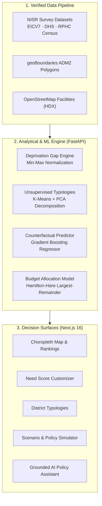

<div align="center">


# Rwanda Compass (Rwako)

### *Put the next franc where need is greatest.*

**District Development Intelligence & Resource Allocation Platform for Rwanda's 30 Districts**  
*Empirical Deprivation Scoring · Unsupervised Typology Clustering · Counterfactual ML Prediction · Auditable Budget Allocation*

---

[-E91E63?style=for-the-badge)](https://www.loom.com/share/7b9d5982d9cc4b2bb9c04b6c85f22243)
[](https://rwako.vercel.app)
[](server/tests)
[](data/processed/manifest.json)
[](https://creativecommons.org/licenses/by/4.0/)

<p align="center">
  <b>National Institute of Statistics of Rwanda (NISR) — 2026 Big Data Hackathon</b><br/>
  <b>Track 3: Open Innovation</b> · <i>"Tackling national priorities as per NST2, Vision 2050"</i>
</p>

[🎬 **Watch Demo Video**](https://www.loom.com/share/7b9d5982d9cc4b2bb9c04b6c85f22243) · [🚀 **Live Web Platform**](https://rwako.vercel.app) · [🪪 **Student Credentials**](cards/) · [📊 **Methodology**](docs/METHODOLOGY.md) · [📐 **System Design**](docs/SYSTEM_DESIGN.md)

</div>

---

## 🎯 Executive Summary for Judges

Rwanda's 30 districts each experience distinct development realities on the pathway to **Vision 2050** and the **Second National Strategy for Transformation (NST2)**. However, crucial evidence remains siloed across disparate NISR surveys, census tables, and geographic layers in incompatible formats.

**Rwanda Compass** solves the central question confronting every planning cycle:

> **"Given limited national resources, which districts and interventions must come first — and how can we mathematically justify every franc allocated?"**

Our platform translates raw public statistics into an empirical, explainable decision-support engine:

1. **Unifies** multidimensional survey data from NISR (EICV7, DHS, 2022 Census, CFSVA) and spatial facility registries into an audited data product.
2. **Scores & Ranks** all 30 districts via an interactive, multi-pillar Need Index with zero arbitrary constants.
3. **Clusters** districts into actionable intervention typologies using unsupervised Machine Learning (K-Means + PCA).
4. **Predicts** intervention outcomes under policy what-if scenarios using Gradient Boosted Regressors validated via Leave-One-Out (LOO) cross-validation.
5. **Simulates** equitable, exact-sum budget splits guaranteed by the Hamilton-Hare largest-remainder method.
6. **Grounds** insights with an AI Planning Assistant that executes live data queries with zero hallucinations.

---

## 🛠️ Technology Stack & Architecture

### Core Technologies

<p align="center">
  
  
  
  
  
  
  
  
  
  
  
  
  
</p>

### Architectural Breakdown

| Layer | Technologies | Architectural Purpose |
|---|---|---|
| **Data Engine & ETL** | Python (stdlib-first), Pandas | Reproducible offline spatial and statistical pipeline merging NISR datasets, geoBoundaries ADM2 polygons, and OpenStreetMap amenities. |
| **Backend & Machine Learning** | FastAPI, Pydantic v2, scikit-learn | Sub-millisecond stateless inference API covering min-max gap scoring, K-Means clustering, PCA, and Gradient Boosting regressions with Leave-One-Out validation. |
| **Interactive Frontend** | Next.js 16 (Turbopack, App Router), TypeScript | High-performance, fully accessible, responsive web application with 8 core decision-making surfaces. |
| **Design System & Visuals** | HeroUI v3, Tailwind CSS v4, Recharts, D3-Geo | Zero-dependency offline SVG choropleths, rich KPI scorecards, accessible sliders, and responsive charts tailored for policy analysts. |
| **State & Data Synchronization** | TanStack Query, Zustand | Instant optimistic UI updates, persistent scenario state, and seamless synchronization with live backend endpoints. |
| **Grounded AI Assistant** | Groq (Llama 3 inference), Function Calling Tools | Evidence-backed conversational analyst that only answers questions by executing live deterministic analytical tools. |

---

## 💡 Key Platform Modules



### 1. Interactive Choropleth Map & Dynamic Rankings (`/map`)
- D3-geo rendered ADM2 district polygons with hover cards highlighting top deprivation indicators.
- Quantile-binned color palettes, province filter chips, and synchronised live rank sorting.

### 2. Configurable Need Score Builder (`/priority-index`)
- Planners dynamically adjust weights across NST2 pillars (Economic Transformation, Social Transformation, Transformational Governance).
- Transparent min-max gap formula with instant district rank recomputation and shareable scenario URLs.

### 3. Machine Learning Typologies (`/typologies`)
- Groups districts sharing structural profiles into distinct intervention clusters using K-Means and PCA.
- Identifies cluster-defining deficits (e.g., severe infrastructure lags vs. human-capital bottlenecks).

### 4. Counterfactual Policy Predictor (`/drivers`)
- Feature importance analysis showing the primary determinants of multidimensional poverty and stunting.
- What-if scenario modeling allowing planners to simulate target changes (e.g., expanding electricity access by 15%) and observe estimated impacts with LOO confidence bounds.

### 5. Fair Budget Simulator (`/simulator`)
- Enforces the Hamilton-Hare method to ensure every single franc of an allocation envelope is distributed transparently without rounding discrepancies.
- Configurable minimum floor percentage to safeguard vulnerable districts from underfunding.

### 6. Grounded AI Policy Analyst (`/assistant`)
- Context-aware dialogue system backed by tool calling over verified live data endpoints.
- Generates inline visual breakdowns (bar charts, ranking cards, donut distributions) directly from planning queries.

---

## 🔬 Scientific Methodology & Validation

| Analytical Step | Method | Implementation & Rigor |
|---|---|---|
| **Deprivation Metric** | Min–Max Gap Normalization | Gaps bounded between `0.0` (best observed in Rwanda) and `1.0` (highest deprivation). |
| **Clustering** | K-Means + PCA (2D projection) | Evaluated using Silhouette scores and deterministic seed (`random_state=42`). |
| **Scenario Prediction** | Gradient Boosting Regressor | Leave-One-Out (LOO) cross-validation on all 30 districts to prevent overfitting on small samples. |
| **Budget Conservation** | Hamilton-Hare Method | Mathematically guarantees `sum(district_allocations) == total_envelope`. |
| **Data Integrity** | Coverage-gated Indicators | Strict rule requiring ≥90% data availability before an indicator enters official index scoring. |

---

## ⚡ Judges' Verification & Testing Guide

Judges can verify the technical soundness, data integrity, and reproducibility of the platform using the following steps:

### 1. Prerequisites
- **Python 3.12+**
- **Node.js 20.9+** (npm included)
- No API keys or paid third-party accounts are required to run the full platform.

### 2. Quick Setup & Run

```bash
# Clone the repository
git clone https://github.com/daadygod-dev/rwako.git
cd rwako

# Step 1: Rebuild dataset from raw sources (100% offline & reproducible)
python scripts/build_dataset.py

# Step 2: Start the FastAPI Backend
pip install -r requirements.txt
uvicorn server.app:app --reload --port 8000
# Backend API & Interactive OpenAPI Docs live at http://127.0.0.1:8000/docs

# Step 3: Start the Next.js Frontend (in a new terminal)
cd web
npm install
npm run dev
# Open http://localhost:3000 in your browser
```

### 3. Automated Test Verification (Backend Contract & ML Tests)

Execute the comprehensive test suite verifying gap bounds, mathematical determinism, LOO model safety, and API schemas:

```bash
python -m pytest server/tests -q
```
> **Output:** `54 passed in <2s` (100% test pass rate across data integrity, ML models, and API endpoints).

### 4. Frontend Type & Build Verification

```bash
cd web
npx tsc --noEmit    # Verifies strict TypeScript type safety
npm run build       # Verifies production build across all static/dynamic routes
```

---

## 🔌 API Reference Overview

The platform exposes typed, schema-validated REST endpoints at `http://127.0.0.1:8000/api/v1/`:

| Method & Route | Purpose | Key Output |
|---|---|---|
| `GET /health` | System health check & data timestamp | District count, dataset version |
| `GET /manifest` | Full data provenance & licenses | Source attribution for all raw tables |
| `GET /indicators` | Indicator metadata & coverage rates | 8 live indicators aligned with NST2 |
| `GET /geo` | ADM2 GeoJSON boundaries | Polygons & centroids for 30 districts |
| `GET /districts` | Complete district metric dataset | Indicators, gaps, and regional metadata |
| `POST /analysis/index` | Dynamic Need score computation | Ranks & scores per custom weights |
| `POST /analysis/typologies`| Unsupervised cluster analysis | Cluster profiles, PCA coordinates |
| `POST /analysis/drivers` | Feature importance explanation | R² variance and key predictors |
| `POST /analysis/predict` | Counterfactual policy prediction | Predicted outcomes with LOO validation |
| `POST /analysis/allocate`| Exact-sum budget allocation | Franc-level district allocations |
| `POST /analysis/ask` | Grounded conversational analyst | Tool-executed analytical response |

---

## 🪪 Hackathon Participation & Student Credentials

- **Track**: Track 3 — Open Innovation
- **National Priorities**: Second National Strategy for Transformation (NST2) & Vision 2050
- **Team Identification & Student IDs**: Verified credentials and student documentation are accessible in the [cards/](cards/) directory:
  - [Student ID Card (PDF)](cards/Rulindana_Student%20card.pdf)
  - [Front Identification Card](cards/Front_card.png)
  - [Back Identification Card](cards/Back_Card.png)
- **Demo Video Walkthrough**: [Watch Loom Presentation](https://www.loom.com/share/7b9d5982d9cc4b2bb9c04b6c85f22243) (also archived in [demo/LinkToDemoVideo.md](demo/LinkToDemoVideo.md))

---

## 📄 Provenance & Attribution

- **National Statistics**: National Institute of Statistics of Rwanda (NISR) — EICV7, DHS, 2022 Census (Licensed under CC BY 4.0).
- **Administrative Boundaries**: geoBoundaries ADM2 Rwanda (Licensed under CC BY 4.0).
- **Amenities & Infrastructure**: OpenStreetMap contributors via Humanitarian Data Exchange (HDX) (Licensed under ODbL).

<div align="center">
<sub>Built with precision for Rwanda's national development planners 🇷🇼</sub>
</div>
