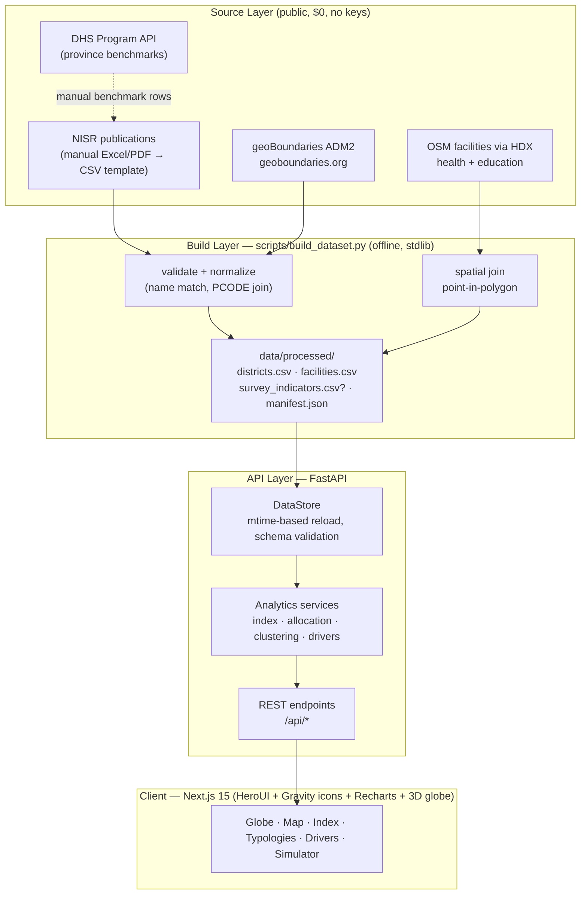
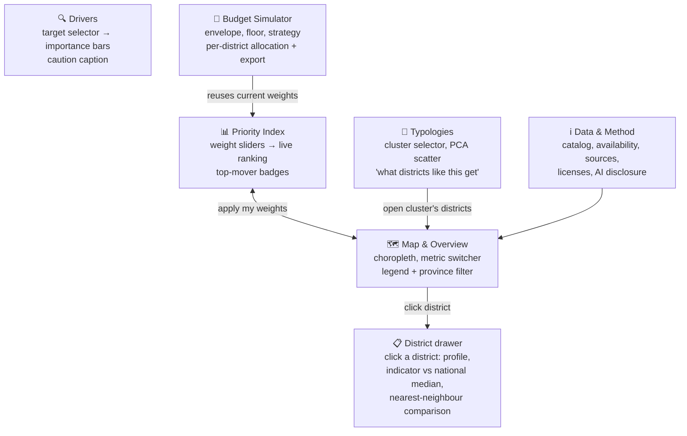
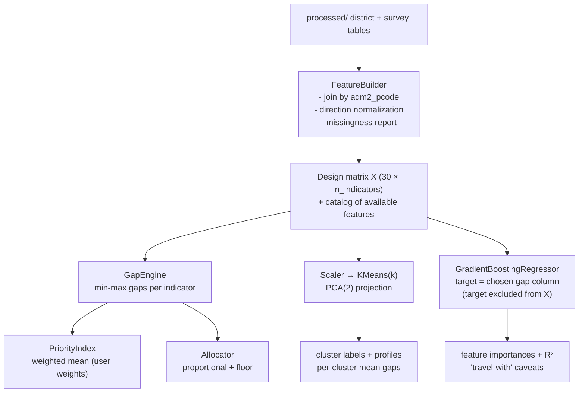

# System Design — Rwanda Compass

> Companion to `METHODOLOGY.md`. This document is the contract for implementation:
> data flow, API contract, UI/UX, interactions, and the ML architecture.

## 0. Design principles

1. **Single source of truth = `data/processed/`**. Nothing in the app hardcodes districts,
   indicator values, or results. A fresh clone + build script + API start reproduces everything.
2. **Catalog-driven, not mock-driven.** One `indicators` catalog (code, label, unit, direction,
   pillar, source) defines what exists. The API computes *availability* from the loaded data and
   tells the UI what can be shown. If NISR survey columns are absent, the UI shows an explicit
   "data needed" state — never fabricated numbers.
3. **All analytics are request-time functions of user parameters** (weights, k, budget, target).
   No precomputed rankings shipped in files; defaults live only in the catalog.
4. **Provenance travels with every payload** (source, license, generation timestamp from
   `manifest.json`) so the UI can display citations — an evaluation-criterion requirement.
5. **Graceful degradation**: map→table, ML features→basic analytics, depending on data coverage.

## 1. System flow



**Data freshness:** the DataStore caches loaded frames keyed on file `mtime`; re-running the
build script updates processed files and the next request picks them up — no redeploy needed.
`manifest.generated_utc` is exposed at `/api/manifest` and rendered as "Data updated: …" in the UI.

## 2. Data product (what ML & API parse)

Phase A today (real, from owned sources): `districts.csv`
(`district, adm2_pcode, province, area_km2, health_facilities, education_facilities,
health_per_1000km2, education_per_1000km2`) + `facilities.csv` + `manifest.json`.

Phase B (when the team fills `data/raw/nisr/district_indicators_TEMPLATE.csv`):
`survey_indicators.csv` — same 30-district keys,Joined by `adm2_pcode`/`district` with a
fuzzy fallback match report.

**Availability rule:** an indicator is *served* only if its coverage across districts ≥ 90%
and variance > 0. `/api/indicators` returns `[available, coverage_pct, n_missing]` per indicator —
the UI renders unavailable indicators as disabled cards with the exact reason. No placeholders.

## 3. API contract (FastAPI)

All POST bodies are plain JSON; errors follow RFC 7807 (`problem+json`). GETs are ETag-cached
and gzipped; auto OpenAPI docs at `/docs`. All responses include `provenance`/`as_of`.

| Method & path | Body | Returns | Notes |
|---|---|---|---|
| GET `/api/v1/health` | — | status | deploy check |
| GET `/api/v1/manifest` | — | provenance manifest | citations in UI |
| GET `/api/v1/indicators` | — | catalog + availability (`coverage_pct`, `n_missing`) per indicator | **drives every UI state** |
| GET `/api/v1/geo` | — | simplified district polygons + centroids | ETag-cached, gzipped |
| GET `/api/v1/districts` | — | district table with all served values | availability rules applied |
| GET `/api/v1/districts/{pcode}` | — | detail: gaps vs national median, rank, nearest neighbours | drawer view |
| GET `/api/v1/facilities` | `?kind=health\|education` | facility points | map overlay |
| POST `/api/v1/analysis/index` | `{weights: {code: float}}` | gaps + index + ranking + coverage | deterministic |
| POST `/api/v1/analysis/allocate` | `{budget_rwf_m, weights, floor_pct}` | allocation per district | proportional + floor |
| POST `/api/v1/analysis/typologies` | `{k: int}` | labels, PCA coords, profiles, silhouette | k ∈ [2,6] |
| POST `/api/v1/analysis/drivers` | `{target_code}` | importances + R² + caveat text | target excluded from features |

**Invalid input → 422 with a field-level message** (e.g. weight out of range 0–5, unknown
indicator code) — never a silent fallback to defaults. CORS locked to the frontend origin.

## 3b. Visualization system

**Stack:** Next.js 15 (App Router, TypeScript) · HeroUI component library (Tailwind) ·
`@gravity-ui/icons` · Recharts · `react-globe.gl` + three.js for the hero 3D globe.

- **3D globe (hero, lazy-loaded `ssr:false`)**: ADM2 polygons rendered via
  `polygonCapColor` + `polygonAltitude`; altitude = active metric value, color = semantic scale.
  Hover → tooltip (value, rank); click → camera flies to district + detail drawer opens.
  Toggle layers: facility points (health/education), cluster coloring mode, auto-rotate,
  reset view.
- **2D choropleth (fallback + comparative view)**: `d3-geo` SVG paths — no SDK, no tiles,
  no keys. Same color language as the globe.
- **Color language**: single-hue sequential "worse = darker red"; colorblind-safe; meaning never
  encoded by color alone; quantile bins (5) default, continuous toggle.
- **Charts** (Recharts): horizontal sorted bars (rankings); 100% stacked "deprivation composition"
  + dumbbell-vs-median in the drawer; PCA scatter for clusters; sorted bars + table + CSV export
  for allocation. No pie/3D/radar.
- **Every chart carries a caption**: source · year · unit · license (from manifest).
- **Polish**: HeroUI Card/Chip/Slider/Table/Skeleton; KPI strip (median, worst district,
  data-updated date from manifest); 200 ms color transitions; tabular numerals; WCAG AA;
  light theme default + dark toggle. Icons exclusively from `@gravity-ui/icons`.

## 4. What the end user sees (information architecture)



### Display decisions (user-facing data representation)

| Data | Representation | Why |
|---|---|---|
| district values | choropleth + ranked bar list (same metric toggle) | spatial + ordinal reading |
| gaps per district | 100% stacked "deprivation bar" in the drawer | shows *composition* of need |
| typology clusters | color-coded map layer **plus** scatter | clusters must stay geographically legible |
| allocation | sorted bars + table with download CSV | auditable output for planners |
| availability gaps | "Data needed" card with source instruction | honest empty states, no mocks |

### 4b. End-user display inventory (what appears on screen, and where its data comes from)

Every element below is fed live from `/api/v1/*` — the frontend contains zero data literals.

**Global shell (all pages)**
| Element | Data source | Behavior |
|---|---|---|
| Navbar: brand + 7 view links (icons from @gravity-ui/icons) | — | active-route highlight |
| Data-freshness chip "Data updated 2026-…" | `GET /manifest` | tooltip → sources |
| Province filter | districts rows (distinct provinces) | filters map/bars/tables everywhere (URL param) |
| Theme toggle; language badge (EN/KIN planned) | — | dark default off |
| KPI strip: #1 priority district · median index · most improved signal · districts count
  (only metrics actually served) | `POST /analysis/index` (default weights) | recomputes with weights |

**1) Globe view — `/` (hero)**
| Display | Data source | Interaction |
|---|---|---|
| 30 district polygons extruded by active metric | `GET /geo` + `POST /analysis/index` or raw values | altitude = value; color = semantic scale |
| Metric selector (only available indicators; unavailable ones shown disabled with reason) | `GET /indicators` | re-extrudes + recolors. farm ~200 ms |
| Cluster-coloring mode | `POST /analysis/typologies` (k from state) | colors by cluster; legend w/ severity |
| Facility points layer (health ⊕ education, toggleable) | `GET /facilities?kind=` | 1,485 real OSM points |
| Hover card: district · value · rank · unit | geo props + index | follows cursor |
| Click → fly-to + drawer | `/districts/{pcode}` | “open full profile” |
| Auto-rotate / reset / flat-2D fallback toggle | — | 2D choropleth for slow devices |

**2) Map & ranking — `/map`**
| Display | Data source | Interaction |
|---|---|---|
| 2D SVG choropleth (quantile bins, hover tooltips) | `GET /geo` + values | legend = bin filter (click to isolate) |
| Synchronized ranked horizontal bars (top→bottom 30) | index endpoint | hovering a bar highlights its polygon |
| Bin legend + continuous-scale toggle + quantile note | — | — |

**3) Priority Index builder — `/index`**
| Display | Data source | Interaction |
|---|---|---|
| Weight sliders per available indicator (0–5) + unavailable rows as disabled chips with reason | `GET /indicators` | debounce 350 ms → `POST /analysis/index` |
| Preset chips: Poverty-first · Education-first · Health-first · Balanced | catalog defaults | sets slider values (URL `?w=` sync) |
| Ranking table (rank, district, province, index, spark) + top-15 bar chart | `POST /analysis/index` | sort toggles; CSV export |
| “What moves” list: largest rank changes vs Balanced preset | client diff of two index calls | explains weight effects |

**4) District typologies — `/typologies`**
| Display | Data source | Interaction |
|---|---|---|
| PCA scatter (x=PC1, y=PC2, color=cluster, label=district) | `POST /typologies` | hover → tooltip; click → drawer |
| Cluster-colored map strip (geographic legibility) | members + geo | click cluster → isolate |
| Profile table: mean gap per indicator per cluster, sorted by severity | profiles rows | column headers from catalog labels |
| k slider (2–6) + silhouette chip | request param | recompute on change |
| “Plan per typology” callout: one-line intervention hint per cluster | profile composition | static text templates |

**5) Poverty/indicator drivers — `/drivers`**
| Display | Data source | Interaction |
|---|---|---|
| Target selector (available indicators only) | `GET /indicators` | triggers `POST /drivers` |
| Importance bars (sorted, % of total), R² chip, n-features | `POST /drivers` | tooltip = code + unit + source |
| Method caption + “companions, not causes” warning | schema caveat field | always visible |
| Unavailable state: “needs NISR survey columns” + link | availability.reason | honest empty state |

**6) Budget simulator — `/simulator`**
| Display | Data source | Interaction |
|---|---|---|
| Envelope input (RWF M) + floor slider (0–50%) + “uses current weights” chip | — | recompute live |
| Sorted allocation bars + table (rank · district · index · RWF · share %) | `POST /allocate` | CSV export (auditable) |
| Concentration readout: share of budget in top-5 districts | client calc | floor experiments |
| Method note + prohibition of zeros | — | — |

**7) District drawer (from globe/map/bars/scatter clicks)**
| Display | Data source | Interaction |
|---|---|---|
| Header: district, province, RWF PCODE, area | `/districts/{pcode}` | — |
| Rank badge (e.g. #7 of 30) + index vs national median (dumbbell chart) | same | — |
| Deprivation composition: 100% stacked gaps (this district vs median gaps) | gaps in detail | hover segment = indicator facts |
| Values table (value · unit · source chip · gap bar) | values + catalog | — |
| Nearest-neighbour chips (similar profile) | neighbours | click → switch district |
| Facilities & schools counts + Density note | facilities counts | — |

**8) Data & method — `/data`**
| Display | Data source | Interaction |
|---|---|---|
| Indicator catalog cards: label, unit, pillar, direction, availability badge + reason | `GET /indicators` | — |
| Provenance table: provider, license, URL, fetched file | `GET /manifest` | links open in new tab |
| Methodology summary + build/run instructions + AI-use disclosure | static MD render | — |

**4c. UX states (applied everywhere)**
- **Loading**: HeroUI Skeleton per block; globe shows progress ring during first polygon load.
- **Empty/insufficient**: explicit “Data needed” card explaining the NISR template step — never mock values.
- **Error**: toast with problem+json `detail` + Retry button.
- **Disabled**: unavailable indicators render grey with reason chip; sliders never fake data.
- **Determinism**: same weights/params → same rendered numbers (enabled by stateless backend).

### 4d. Interactions (state & feedback)
- **Weight sliders** (0–5, step 0.5, preset chips) → debounce 350 ms → index recompute → globe/2D recolor + ranking in one animation; `?w=` URL sync so views are shareable.
- **District click** → side drawer (no route change), ESC/backdrop closes.
- **Metric select** → legend + scale adapt.
- **Budget input** → currency input (RWF M) + floor slider; result table sortable, CSV export.
- **k slider** (2–6) → cluster globe/map + scatter + silhouette chip.
- All requests carry skeleton states; errors get a retry affordance with the API error message.

## 5. ML architecture



**Design rules**

- **Stateless inference**: every model is fit inside the request from the current data matrix
  (n=30 rows → training is milliseconds). This guarantees results always reflect the latest
  file on disk — no stale artifacts, no mock embeddings. Determinism is controlled via `random_state`.
- **No leakage**: driver analysis never includes the target column in X; the UI states
  "companion indicators, not causal proof".
- **Coverage gating**: any indicator with < 90% coverage is excluded from the design matrix and
  reported, so ML never runs on fabricated interpolation.
- **Silhouette reported** alongside clusters so k-choice is evidence-based.
- **Future (post-hackathon)**: intervention cost curves, per-district time series (EICV waves),
  and scenario optimization (linear programming) — documented, not stubbed.

## 6. Repo layout (target)

```
scripts/build_dataset.py       # existing builder (offline, stdlib)
server/                        # FastAPI app (done — M2a)
  app.py  datastore.py  schemas.py  catalog.py
  services/analytics.py
  tests/                       # 15 tests + synthetic fixtures (tests only)
web/                           # Next.js 15 + HeroUI (next sprint — M2b)
  app/(views)/                 # globe · map · index · typologies · drivers · simulator · data
  components/                  # DistrictDrawer, KpiStrip, MetricSelect, Legend, charts/
  lib/api.ts                   # typed client for /api/v1 (TanStack Query)
docs/                          # METHODOLOGY.md, SYSTEM_DESIGN.md
```

Frontend env: `NEXT_PUBLIC_API_URL=http://127.0.0.1:8000` (dev) — API CORS allows Next.js
default port 3000 and Vite 5173. The globe view is a client component with a dynamic
`ssr:false` import; everything else renders/streams server-side where practical.

## 7. Definition of done (per milestone)

- M2 backend: schema-validated endpoints above + unit tests with tiny fixture CSVs
  (fixtures live under `server/tests/fixtures/`, are *synthetic explicitly for tests only*)
  + a smoke run against real `data/processed`.
- M2 frontend: all six views wired to live API, zero hardcoded district names/values in `web/src`.
- M3: survey template filled → features light up; availability chips flip to green with sources.
- M4: deploy (Cloudflare Pages + Render free tier), README screenshots, demo script.
